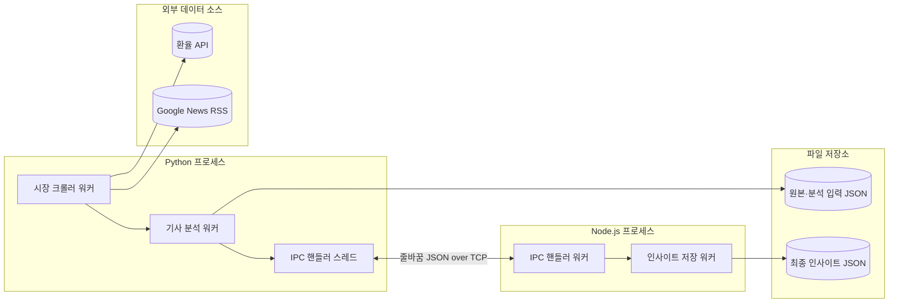

# 시스템 아키텍처

## 목적

Python 프로세스가 환율 시계열과 뉴스 RSS를 수집하고 관련 기사를 선별한다. Node.js 프로세스는 선별된 데이터를 바탕으로 통화별 추이와 기사 기반 변화 이유를 분석해 최종 인사이트를 저장한다.

## 전체 구성



## 프로세스별 책임

### Python 프로세스

실행 파일은 `process_and_thread.py`이다.

- 워커 스레드 생성 및 종료 관리
- 환율 API와 뉴스 RSS 수집 시작
- 기사 관련성 선별
- Node.js 프로세스 실행
- IPC로 분석 입력 파일과 출력 파일 경로 전달
- Node.js의 저장 완료 응답 대기

### Node.js 프로세스

실행 파일은 `node_process.js`이다.

- Python과 TCP IPC 연결 유지
- Python이 만든 분석 입력 파일 읽기
- 통화별 5일 단순 이동평균 계산
- 최신값과 이동평균의 차이를 이용한 추이 판단
- 기사 헤드라인, 관련 내용, 변화 이유 키워드 추출
- 최종 인사이트 JSON 저장

## 스레드 구성

| 프로세스 | 스레드 | 책임 |
|---|---|---|
| Python | 시장 크롤러 워커 | 환율 시계열 및 뉴스 RSS 수집 |
| Python | 기사 분석 워커 | 환율 관련 기사 선별 및 Node 입력 생성 |
| Python | IPC 핸들러 스레드 | Node와 TCP 메시지 송수신 |
| Node.js | IPC 핸들러 워커 | Python 메시지 수신 및 응답 전송 |
| Node.js | 인사이트 저장 워커 | 파일 읽기, 이동평균 분석, 인사이트 저장 |

## 상태 머신

Python 워커는 역할에 맞는 상태를 별도로 가진다.

- 시장 크롤러: `IDLE -> FETCHING_RATES -> FETCHING_NEWS -> SENT -> WAITING -> STOPPED`
- 기사 분석기: `IDLE -> RECEIVING -> FILTERING -> SAVING -> WAITING -> STOPPED`
- 모든 Python 워커에는 예외 상황을 위한 `ERROR` 상태가 있다.

Node 워커도 역할별 상태를 가진다.

- IPC 핸들러: `CONNECTING -> CONNECTED -> RECEIVING -> CONNECTED -> STOPPED`
- 인사이트 저장기: `IDLE -> READING -> ANALYZING -> SAVING -> WAITING -> STOPPED`
- Node 프로세스: `STARTING -> RUNNING -> WAITING -> STOPPING -> STOPPED`

상태 전이는 로그에 이전 상태, 새 상태, 원인 이벤트를 함께 기록한다.

### `IDLE`로 돌아가지 않는 이유

현재 프로그램은 계속 실행되는 서버가 아니라 **한 번의 수집·분석·저장 작업을 수행하는 배치 실행**이다. 따라서 `IDLE`은 아직 작업을 받지 않은 시작 상태이고, 작업을 끝낸 워커는 `WAITING`에서 완료 응답과 종료 명령을 기다린 뒤 `STOPPED`로 간다.

```text
IDLE      시작 전
WAITING   현재 작업 완료, 다음 제어 메시지 대기
STOPPED   이번 실행의 정상 종료
```

`STOPPED`는 실행 단위의 종단 상태이므로 다시 `IDLE`로 돌아가지 않는다. 지속형 서비스로 바꾸려면 `STOPPED` 대신 다시 작업을 받을 수 있는 `IDLE` 또는 `READY` 상태로 전환하는 별도의 재실행 정책이 필요하다.

## 결합도와 경계

- Python 내부 워커 간 통신은 `queue.Queue`와 `Message` 객체를 사용한다.
- Python과 Node 사이에는 프로세스 간 직접 객체 공유를 하지 않는다.
- 프로세스 간 계약은 줄바꿈으로 구분되는 JSON 메시지이다.
- 대용량 데이터 자체는 IPC로 보내지 않고 JSON 파일 경로를 보낸다.
- 따라서 IPC 메시지는 작고, 파일은 데이터 저장 경계로 동작한다.
