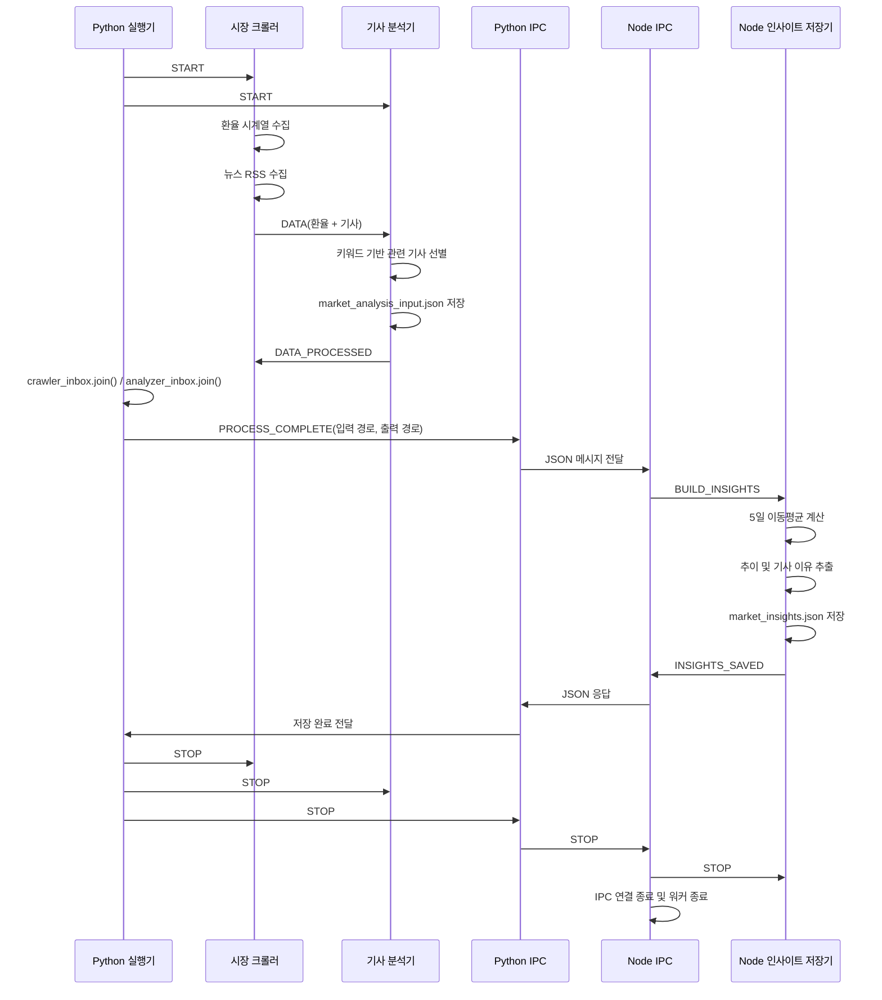

# 데이터 흐름

> 이 문서는 `project/legacy/` 프로토타입의 실행 흐름을 설명한다. 구현을 마친 FastAPI/PostgreSQL의 수집·분석·조회 흐름은 [현재 시스템 검증 보고서](verification.md)를 참고한다.

## 한 번의 실행 흐름



## IPC 용어: 줄바꿈 JSON over TCP

`줄바꿈 JSON over TCP`는 별도의 복잡한 메시지 프레임워크 없이 TCP 연결 위에 JSON 한 객체를 한 줄로 보내는 방식이다.

```text
{"type":"PROCESS_COMPLETE", "analysisInputPath":"...", "outputPath":"..."}\n
```

- **TCP**: Python IPC 핸들러와 Node IPC 핸들러 사이의 localhost 네트워크 연결
- **JSON**: 메시지의 데이터 형식
- **줄바꿈**: 한 메시지의 끝을 표시하는 구분자

수신자는 TCP에서 읽은 데이터를 버퍼에 쌓고 `\n`을 기준으로 메시지를 분리한 다음 JSON으로 파싱한다. TCP는 메시지 경계를 보장하지 않기 때문에 버퍼와 줄바꿈 구분이 필요하다.

## 단계별 흐름

### 1. 실행 준비

`process_and_thread.py`가 다음을 준비한다.

1. Python 워커용 큐 2개 생성
2. Python IPC 핸들러 시작
3. Node.js 프로세스 실행
4. 시장 크롤러와 기사 분석기 스레드 시작

### 2. 외부 데이터 수집

시장 크롤러 워커가 다음 데이터를 수집한다.

- 환율: Frankfurter API의 USD 기준 주요 통화 시계열
- 뉴스: Google News RSS의 환율·통화·금리 관련 검색 결과
- 기사 본문: RSS의 각 링크를 따라가 HTML 텍스트를 추출하고, 요청 실패 시 RSS 설명 사용

현재 HTML 파서는 script/style/nav 등 일부 요소를 제외하지만, 구현 조건상 `<article>`·`<main>` 밖의 텍스트도 포함할 수 있다. 본문 영역만 엄격히 추출하는 파서로 보장되는 것은 아니다.

수집 결과는 우선 `market_data_raw.json`에 원본 형태로 저장된다.

### 3. 기사 관련성 분석

기사 분석 워커는 제목과 설명을 합친 텍스트에서 다음 계열의 키워드를 찾는다.

- 환율: `exchange`, `rate`, `currency`
- 통화: `dollar`, `euro`, `pound`, `yen`, `yuan`, `won`
- 거시 요인: `central bank`, `inflation`, `interest`

RSS 제목뿐 아니라 수집된 기사 본문까지 합쳐 관련 키워드를 검색한다. 관련 키워드가 2개 이상 발견된 기사만 관련 기사로 분류한다. 결과는 `market_analysis_input.json`에 저장된다.

### 4. Python에서 Node로 전달

`DATA_PROCESSED`는 기사 분석 워커가 시장 크롤러 워커에 보내는 내부 완료 메시지다. 이 메시지가 Python 실행기를 직접 깨우는 것은 아니다. 실행기는 두 큐에 넣은 메시지가 모두 소비되었는지를 `Queue.join()`으로 확인한다.

Python의 `process_and_thread.py`는 다음 두 조건을 확인한 뒤 Node에 `PROCESS_COMPLETE`를 보낸다.

1. `crawler_inbox.join()`이 반환됨: `DATA_PROCESSED`까지 시장 크롤러가 소비함
2. `analyzer_inbox.join()`이 반환됨: `DATA`를 기사 분석기가 소비하고 입력 파일을 저장함
3. `market_analysis_input.json`이 실제로 존재함

그 후 Python은 기사와 환율 데이터 전체를 IPC로 직접 전송하지 않고 다음 경로 정보만 전달한다.

```json
{
  "type": "PROCESS_COMPLETE",
  "analysisInputPath": ".../market_analysis_input.json",
  "outputPath": ".../market_insights.json"
}
```

### 5. Node 분석 및 저장

Node 인사이트 저장 워커는 입력 파일을 읽고 다음을 수행한다.

1. 통화별 환율 값 배열 추출
2. 최근 5개 값의 단순 이동평균 계산
3. 최신 환율과 이동평균의 차이 계산
4. `상승 추이`, `하락 추이`, `이동평균 부근의 보합 추이` 판정
5. 기사에서 헤드라인, 관련 내용, 이유 후보 키워드 추출
6. `market_insights.json` 저장

### 6. 종료 흐름

Node의 인사이트 저장 워커는 저장 완료를 알리는 `INSIGHTS_SAVED`를 보낼 뿐, 스스로 `STOP`을 보내지 않는다. 종료 명령의 소유자는 Python 실행기다.

1. Node 인사이트 저장 워커가 `INSIGHTS_SAVED`를 Node 프로세스에 보냄
2. Node 프로세스가 이를 Python IPC 핸들러를 통해 Python 실행기에 전달
3. Python이 Python 워커에 `STOP`을 보내고 `thread.join()`으로 종료를 기다림
4. Python이 Node IPC 핸들러에 `STOP`을 보냄
5. Node 프로세스가 인사이트 저장 워커에 `STOP`을 전달함
6. Node IPC 연결과 두 Node 워커를 종료함

즉, 인사이트 저장 워커가 `STOP`을 보내지 않는 것은 누락이 아니라 **생명주기 제어를 상위 프로세스가 담당하도록 한 설계**다.

## 오류 흐름

- 수집 실패: 크롤러가 `ERROR` 상태가 되고 분석 워커에 `ERROR` 메시지를 보낸다.
- 분석 입력 파일 미생성: Python은 Node 호출을 중단하고 명확한 오류를 발생시킨다.
- Node 파일 처리 실패: Node가 `NODE_ERROR`를 Python에 보내고 Node 프로세스를 `ERROR` 상태로 전환한다.
