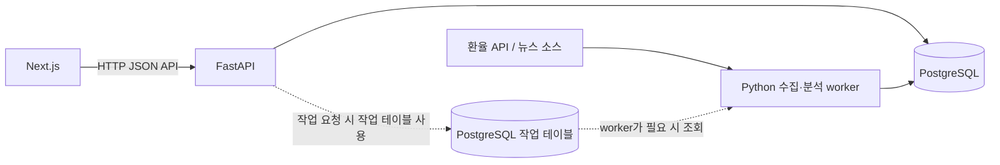

# 구현 계획: 환율·뉴스 분석 서비스 전환

## 목표

현재 Python·Node.js·파일·TCP IPC로 구성된 배치 프로그램을 다음 기술로 단계적으로 전환한다.

- Backend API: Python + FastAPI
- 데이터 저장: PostgreSQL
- 분석 및 수집 worker: Python 프로세스
- Frontend: Next.js
- 스키마 변경 관리: Alembic

핵심은 먼저 데이터 저장과 분석 결과를 안정적으로 정의하고, 그 위에 API와 화면을 얹는 것이다. 모든 구성 요소를 한 번에 바꾸지 않고 동작 가능한 단위로 전환한다.

## 범위와 제외 항목

### 포함

- JSON 파일 대신 PostgreSQL에 환율, 기사, 분석 결과, 이벤트, 알림 저장
- FastAPI를 통한 데이터 조회와 작업 요청
- 수집·분석 worker와 API의 프로세스 분리
- 최근 N일 환율 시계열 및 5일·20일·60일 이동평균
- 추세 상태, 기사 관련도, 이벤트 타임라인
- 정책 관련 키워드와 시계열 변곡점 연계
- 급등·급락, 추세 반전, 기사 키워드와 가격 변동 연동 알림
- Next.js 대시보드

### 이번 범위에서 하지 않음

- Celery 도입
- Redis 또는 RabbitMQ 도입
- 관측성/모니터링 시스템 도입
- Node.js를 분석 backend로 유지

비동기 작업 요청과 worker 분리가 필요해지면 PostgreSQL 작업 테이블을 사용할 수 있다. 이는 별도 메시지 브로커가 아니며, 우선 API와 worker의 기본 데이터 흐름을 만든 뒤 필요한 경우에만 추가한다.

## 목표 구조



- FastAPI는 HTTP 요청, 검증, 조회, 작업 요청 접수를 맡는다.
- Python worker는 외부 데이터 수집과 시간이 걸리는 분석을 맡는다.
- PostgreSQL은 서비스 간 공유 저장소이자 데이터 계약의 기준이다.
- 처음에는 worker를 명령행으로 독립 실행하고, API에서 비동기로 작업을 요청해야 할 때만 DB 작업 테이블을 추가한다.
- Node.js의 수집·분석·IPC 역할은 Python backend로 옮긴다. Next.js는 frontend 용도로만 사용한다.

## 저장소 폴더 구조

저장소 루트에서는 문서를 `docs/`에, 실행 가능한 프로젝트 구성요소를 `project/`에 둔다. 기존 실행 코드는 전환이 끝날 때까지 `project/legacy/`에 보존한다.

```text
software_architecture/
├── docs/
│   ├── architecture.md
│   ├── codebase-guide.md
│   ├── data-flow.md
│   ├── data-structure.md
│   └── implementation-plan.md
└── project/
    ├── backend/
    │   ├── app/
    │   │   ├── api/v1/       FastAPI route와 API 버전
    │   │   ├── core/         설정과 공통 예외
    │   │   ├── db/           DB 연결, 세션, Base
    │   │   ├── models/       SQLAlchemy 모델
    │   │   ├── schemas/      Pydantic 요청·응답 스키마
    │   │   ├── services/     수집 데이터 처리와 분석 규칙
    │   │   └── workers/      독립 실행 가능한 수집·분석 작업
    │   ├── migrations/       Alembic 설정과 버전 이력
    │   └── tests/            backend 테스트
    ├── frontend/
    │   ├── app/              Next.js App Router 페이지와 layout
    │   ├── components/       charts/ 및 layout/ UI 구성요소
    │   ├── lib/api/          FastAPI client와 API 타입
    │   ├── public/           정적 리소스
    │   └── tests/            frontend 테스트
    └── legacy/               기존 Python·Node.js·JSON 프로토타입
```

`project/backend/`에는 FastAPI 앱, 환율 조회 endpoint, ORM 모델, Alembic 초기 revision이 있다. `project/frontend/`에는 Next.js dashboard scaffold가 있고 환율 API 조회를 연결했다. `docs/`의 아키텍처·데이터 흐름·데이터 구조 문서는 `project/legacy/`의 기존 동작을 설명하고, 이 구현 계획은 새 목표 구조와 진행 상태를 설명한다.

## 진행 현황

### 완료

- 수집·분석 pipeline을 PostgreSQL 영속 상태 머신으로 전환했다. Job queue, 단계/시도 이력, 최대 3회 자동 retry, crash recovery, 중복 요청/실행 방지 및 별도 worker 실행을 구현했다. Next.js의 Background logs에서 작업 요청·진행·이력·실패·retry를 확인할 수 있다. Backend 테스트 60개, 실제 worker 강제 종료 후 복구, browser 작업 제출/수동 retry 및 mobile 폭을 검증했다. [상태 머신 가이드](job-state-machine.md)를 참고한다.
- Dashboard에서 외화 1단위의 원화 가격이 목표값 이하/이상일 때 알림을 생성하도록 설정할 수 있다. 즉시 평가, pause/resume/delete, 수동 확인, 30초 주기 발생 내역 조회를 연결했다. 같은 규칙·quote 날짜에는 중복 알림을 만들지 않으며 규칙 삭제 후에도 발생 이력을 보존한다. Backend 테스트 51개와 실제 browser의 생성·발생·일시정지·재개·삭제 및 mobile 폭을 검증했다.
- KRW를 기본 통화로 전환했다. Dashboard의 대표 가격·차트·이동평균은 외화 1단위의 원화 가격(예: 1 USD에 필요한 KRW)을 표시한다. 낮을수록 외화를 사는 원화 비용이 작다. 역수 변환은 각 날짜의 시세에 먼저 적용한 뒤 이동평균과 추세를 다시 계산한다. 수집·기사·이벤트·알림을 통화쌍 기준으로 연결했고, 기존 USD history는 보존했다. 작은 KRW-base 환율의 반올림 오차는 USD 시세에서 Decimal 교차 계산하여 방지한다. Backend 테스트 42개와 실제 dashboard 연동을 검증했다.
- Node.js 24 LTS가 사용자 영역에 설치되어 있고 npm을 사용할 수 있다.
- Next.js dashboard에 통화·기간 선택, 환율/이동평균 차트, 기사 관련도, event timeline, alert 결과 및 API/DB 상태 표시를 연결했다.
- FastAPI health, 환율 시계열, 기사 관련도, event timeline, alert 규칙/발생 내역 API를 구현했다.
- PostgreSQL portable 17.11을 `%LOCALAPPDATA%`에 준비하고 비-superuser 앱 DB를 생성했다. Alembic migration을 실제 PostgreSQL에 적용했다.
- Frankfurter 환율 수집 worker, 뉴스 RSS/본문 수집 및 upsert, 기사별 관련도·정책 키워드, 변동/추세 신호 분석 및 alert evaluator를 구현했다.
- API 응답을 막지 않는 startup catch-up과 실행 중 매일 재수집을 APScheduler로 연결했다. 환율은 365일 upsert, 뉴스는 7일 window 단위 commit으로 재수집한다.

### 환경 제약 및 다음 순서

- 실제 PostgreSQL 연결, migration, 365일 환율 적재(2,032 observations), `/api/v1/rates` 응답을 검증했다.
- `RATE_HISTORY_DAYS` 기본값은 365일이다. 앱이 꺼져 있어도 다음 시작 시 기간 전체를 재조회하고 기존 행은 upsert한다. scheduler는 앱 실행 중에만 돈다.
- `NEWS_HISTORY_DAYS` 기본값은 90일이다. 과거 구간은 RSS 요약을 7일씩 commit하고 최근 7일은 본문도 수집한다. Google News의 과거 RSS 검색 범위는 공급자 한계가 있어 완전성을 보장하지 않는다.
- 뉴스 backfill은 startup background job으로 진행하며, 7일 단위로 결과를 commit한다. 공급자 응답/본문 크롤링 실패는 다음 시작 또는 일일 검색에서 재시도한다.
- 2026-10-16: 90일 뉴스 worker가 historical summaries 96건과 recent articles 12건을 처리했다. URL 중복 제거 후 기사 110건이 저장되었으며, 공급자가 노출하지 않는 과거 기사의 완전성은 보장하지 않는다.
- PostgreSQL clean restart 후 환율 2,032건, 기사 110건, trend snapshot 2,032건, timeline event 119건이 유지됨을 확인했다. 분석 재실행 시 추가 event는 0건이었다.
- 수집 이후 분석을 연결하고 독립 `python -m app.workers.analyze_market` 진입점을 추가했다. `/api/v1/trends`는 최신 통화별 지표와 판정 기준을 반환하고, change-point alert 규칙도 지원한다.
- Backend 테스트 32개와 실제 DB 기반 health/rates/trends/articles/events/alerts 응답을 검증했다.
- Next.js lint와 production build(TypeScript 포함)가 통과했다.
- 전환 검증 완료: legacy 표본 248개 환율과 8개 통화의 MA5/일간 변화율이 일치했다. 전체 snapshot의 이동평균 6,096개와 24개 통화·기간 조합 API도 확인했다. 추세·기사 점수는 새 규칙에 따라 검증했으며, legacy와 동일한 결과를 요구하지 않는다.
- 검증 중 기간 선택에 따른 이동평균 초기화, 기사 발행일 필터, 정책 alert 관련도/중복, calendar-day lookback 및 원천 수정 후 event 갱신을 바로잡았다. Backend 테스트 36개가 통과했다. 현재 로컬 버전의 기능 완료 기준을 충족하며, 상세 결과는 [검증 보고서](verification.md)에 기록했다.
- legacy는 비교 자료로 보존하며 신규 backend/frontend는 IPC·JSON 결과 파일에 의존하지 않는다.
- Celery, Redis/RabbitMQ, 관측성/모니터링은 도입하지 않는다.

## 데이터 모델 초안

| 테이블 | 주요 내용 |
|---|---|
| `exchange_rates` | 기준 통화, 대상 통화, 날짜, 환율, 출처. 통화쌍과 날짜 조합은 중복되지 않게 한다. |
| `articles` | 제목, 본문/요약, URL, 출처, 발행 시각, 수집 시각 |
| `article_keywords` | 기사별 키워드, 키워드 종류(일반/정책), 점수 |
| `article_relevance` | 기사와 통화/분석 기간별 관련도 점수 및 근거 |
| `trend_snapshots` | 통화, 기준일, MA5/MA20/MA60, 변화율, 추세 상태, 신호 강도 |
| `events` | 통화, 이벤트 유형, 설명, 발생 시각, 관련 기사, 신뢰도 |
| `alert_rules` | 사용자가 설정한 통화·조건·임계값·활성화 여부 |
| `alert_events` | 실제 조건 발생 기록, 측정값, 발생/해제 시각, 상태 |
| `analysis_jobs` (필요 시) | 작업 유형, 입력 범위, 상태, 시작/완료 시각, 오류 요약 |

초기 모델은 필요한 기능을 구현할 만큼만 만든다. 기사 관련도와 이벤트의 상세 기준은 분석 결과를 확인하면서 조정한다.

## 분석 기능 정의

### 환율 시계열 및 추세

- 조회 기간 `N`일과 통화 코드를 API 입력으로 받는다.
- 일별 환율에서 5일·20일·60일 이동평균을 계산한다.
- 관측값이 충분하지 않은 기간의 이동평균은 `null`로 반환한다.
- `trend`는 상승/하락/중립만 표시하지 않고, 사용한 지표와 계산 기준을 함께 반환한다.
- 추세 반전은 이동평균 교차나 기울기 변화 등 명시한 규칙으로 판정하고, 기준일과 근거 지표를 저장한다.

### 기사 관련도와 이벤트

- 제목과 수집 가능한 본문을 기준으로 관련 키워드와 통화를 판별한다.
- 기사별 관련도에는 점수와 매칭 근거를 함께 저장한다.
- 중앙은행, 금리, 물가, 통화정책 등 정책 키워드는 일반 키워드와 구분한다.
- 정책 관련 기사 발행 시각과 환율 변곡점/비정상 변동 구간을 연결해 event timeline에 표시한다.
- 시간적 근접성은 연관 후보를 만드는 근거일 뿐, 기사로 인해 가격이 변했다고 단정하지 않는다.

### Change point 및 가격 변동

- 우선 기준선은 일간 변화율과 이동평균 기울기를 이용한 규칙 기반 탐지로 구현한다.
- 탐지 결과에는 시점, 통화, 변화 크기, 판정 방식, 신뢰도 또는 강도를 기록한다.
- 통계적 change point 알고리즘 도입은 기준선 결과와 데이터량을 확인한 뒤 별도 결정한다.

### Alert 조건

초기 alert 유형:

- 설정한 기간 대비 환율 급등 또는 급락
- MA5/MA20/MA60 교차 또는 추세 반전
- change point 후보 발생
- 정책 키워드 기사 집중과 환율 변동이 같은 기간에 함께 발생

각 alert는 통화, 평가 기간, 임계값, 실제 측정값, 설명, 발생 시각을 저장한다. 최초에는 alert 발생 내역 조회까지만 구현하고 외부 이메일/메신저 전송은 후속 범위로 둔다.

## API 초안

| 메서드와 경로 | 목적 |
|---|---|
| `GET /api/rates` | 통화와 최근 N일 환율·이동평균 조회 |
| `GET /api/trends` | 통화별 최신 추세 상태 및 근거 조회 |
| `GET /api/articles` | 기간, 통화, 관련도 기준 기사 조회 |
| `GET /api/events` | 기사·정책 키워드·가격 변동 이벤트 타임라인 조회 |
| `GET /api/alerts` | 발생한 alert 내역 조회 |
| `POST /api/alerts/rules` | alert 조건 생성 |
| `POST /api/jobs/collection` | 수집/분석 작업 요청. 비동기 실행이 필요해지는 단계에서 추가 |

응답 형식, 오류 형식, 페이지네이션은 구현 전에 공통 규칙으로 정한다. API가 내부 DB 모델을 그대로 외부 계약으로 노출하지 않도록 응답 스키마를 분리한다.

## 단계별 구현 순서

### 1단계: 저장소와 스키마 기반

- PostgreSQL 개발 환경과 설정값 준비
- Python backend 의존성 및 설정 구조 구성
- SQLAlchemy 모델과 DB 연결 구성
- Alembic 초기 마이그레이션으로 테이블 생성
- 환율·기사의 고유 키와 인덱스 설계

### 2단계: 수집 데이터를 DB로 전환

- 기존 환율 API 및 뉴스 수집 로직을 재사용 가능한 Python 모듈로 분리
- 수집한 환율과 기사를 PostgreSQL에 upsert
- 중복 수집과 일부 수집 실패를 처리
- 기존 JSON 출력은 전환 확인을 위한 임시 비교 용도로만 유지 후 제거

### 3단계: 시계열 분석과 기사 분석

- 최근 N일 조회 모델 및 MA5/MA20/MA60 계산
- 추세 상태와 반전 규칙 구현
- 기사 키워드 추출, 관련도 점수 및 근거 저장
- change point 기준선과 정책 키워드 이벤트 연결
- 급등·급락 및 추세 관련 alert 평가 결과 저장

### 4단계: FastAPI와 worker 분리

- 조회 API를 DB 기반으로 구현
- 수집·분석 worker를 API 프로세스와 독립 실행 가능하게 구성
- 첫 버전은 worker를 명령행/스케줄러에서 실행
- API로 작업을 제출해야 할 때 PostgreSQL `analysis_jobs`와 worker polling을 추가
- worker가 동시에 같은 작업을 가져가지 않도록 트랜잭션 잠금 사용

### 5단계: Next.js 대시보드

- 통화 및 기간 선택이 가능한 환율 차트와 이동평균 표시
- 추세 상태와 변화 근거 표시
- 관련도 순 기사 목록 제공
- 이벤트 타임라인과 alert 내역 표시
- frontend는 FastAPI 계약을 통해서만 backend 데이터 접근

### 6단계: 전환 및 기존 구조 정리

- 기존 실행과 새 backend 결과를 같은 기간으로 비교
- 수집 건수, 환율 값, 관련 기사, 추세 판정 차이 확인
- Node IPC와 JSON 파일 의존성 제거
- README 및 기존 아키텍처 문서를 새 실행 방식에 맞게 갱신

## Alembic 적용 판단

Alembic은 PostgreSQL 서버나 데이터베이스 자체를 생성하는 도구가 아니다. 데이터베이스 접속 후 테이블/컬럼/인덱스 등 스키마 변경을 버전으로 관리하고 적용한다.

이 프로젝트는 처음부터 DB 스키마를 만들고 이후 변경 이력을 추적해야 하므로, SQLAlchemy 모델을 정한 뒤 초기 마이그레이션을 만드는 것이 적절하다. 단, PostgreSQL 설치·실행과 데이터베이스 생성 및 접속 계정 설정은 별도로 먼저 준비해야 한다.

## 완료 기준

- 같은 환율·기사 데이터를 중복 적재해도 중복 행이 생기지 않는다.
- API에서 통화별 최근 N일 시계열과 MA5/MA20/MA60을 조회할 수 있다.
- 데이터 부족 시 이동평균을 잘못 계산하지 않고 명확히 표시한다.
- 기사 관련도와 매칭 키워드 근거를 조회할 수 있다.
- 정책 관련 이벤트, 변곡점 후보, 가격 변동을 시간순으로 볼 수 있다.
- alert 규칙 평가 결과와 발생 근거가 DB에 남는다.
- Next.js가 FastAPI를 통해 필요한 대시보드 데이터를 표시한다.
- Redis, RabbitMQ, Celery 및 모니터링 시스템 없이 위 흐름을 실행할 수 있다.

## Implemented experimental extension: local news-aware forecasts

Added local extractive news evidence, CPU LSTM candidates, chronological validation/held-out evaluation, baseline selection, persisted forecast jobs, and a Next.js Forecast panel. Real news-model eligibility remains gated on sufficient point-in-time history; implementation completion does not establish predictive usefulness. See [forecasting details](news-forecasting.md).
