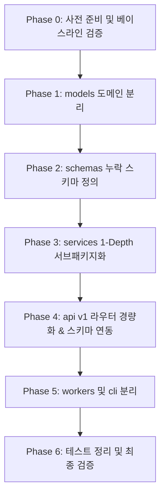

# Backend (`project/backend/app`) 계층 구조 개선 및 서브패키지화 작업 계획서

**작성일**: 2026-10-21  
**기반 문서**: [docs/audit/backend-architecture-audit.md](../audit/backend-architecture-audit.md)  
**대상 범위**: `project/backend/app/` 및 관련 단위 테스트  
**문서 상태**: 실행 준비 완료 (Draft for Execution)

---

## 1. 개요 및 리팩토링 목표

본 문서는 `backend-architecture-audit.md`의 구조 감사 결과를 바탕으로, 평면적으로 과밀화된 `services/` 디렉토리와 비대해진 `models/market.py`를 **도메인별 1-Depth 서브패키지로 체계적으로 재분류**하기 위한 구체적인 단계별 실행 계획(Action Plan)입니다.

### 핵심 목표
1. **1-Depth 서브패키지화**: `services/` 하위 16개 파일을 5개 핵심 도메인(`rates/`, `news/`, `forecasting/`, `alerts/`, `pipeline/`)으로 패키지화.
2. **도메인 모델 분리**: 단일 거대 모델 파일(`models/market.py`)을 `rates.py`, `news.py`, `alerts.py`로 분할하여 응집도 극대화.
3. **스키마 및 타입 안정성 강화**: `trends`, `events`, `forecasts`에 누락된 Pydantic Response DTO 작성 및 라우터 적용.
4. **무중단 점진적 전환 (Zero Regression)**:
   * **Facade / Re-export 패턴**을 적용하여 기존 95개 단위/통합 테스트 및 Alembic 마이그레이션이 어느 단계에서도 깨지지 않도록 보장.
5. **책임 명확화**: 1회성 마이그레이션/백필 스크립트를 상시 워커(`workers/`)에서 관리자용 CLI(`cli/`)로 분리.

---

## 2. 기본 원칙 및 아키텍처 규칙

* **단방향 의존성 규칙 (Top-down Dependency)**:
  $$\text{api} \longrightarrow \text{services} \longrightarrow \text{models / db / core}$$
  * `services/pipeline/`(작업 큐/워커 러너)는 타 도메인 서비스를 호출할 수 있으나, 역방향 의존성을 금지하여 순환 참조(Circular Import)를 원천 차단합니다.
* **하위 호환성 보장 (Compatibility Bridge)**:
  * 파일 이동 시 기존 경로(`app.services.jobs`, `app.models.market` 등)에 re-export stub을 남기거나 상위 `__init__.py`에 노출하여, 점진적으로 import를 갱신할 수 있도록 합니다.
* **단계별 테스트 검증 (Step-by-Step Gate)**:
  * 각 Phase 작업이 완료될 때마다 `PYTHONPATH=project/backend pytest`를 실행하여 95개 테스트 통과 여부를 즉시 검증합니다.

---

## 3. 단계별 상세 실행 계획 (Phased Execution Plan)



---

### Phase 0: 사전 준비 및 베이스라인 검증

* **목표**: 리팩토링 시작 전 작업 트리 상태 및 테스트 기준선을 확보합니다.
* **작업 항목**:
  1. Git 작업 트리 상태 확인 (깨끗한 커밋 상태 확인).
  2. 현재 테스트 기준선 확인:
     ```bash
     PYTHONPATH=project/backend uv run --python project/backend/.venv pytest project/backend/tests
     ```
     *(결과: 95 passed, 5 skipped 확인 완료)*
  3. Alembic 스키마 드리프트가 없는지 사전 확인:
     ```bash
     cd project/backend && uv run alembic check
     ```

---

### Phase 1: `models/` 도메인별 분리 및 호환성 보장

* **목표**: 8개 모델이 모여 있는 `models/market.py`를 도메인별로 분할하고, Alembic 및 기존 코드의 호환성을 유지합니다.
* **세부 작업**:
  1. **신규 모델 파일 생성**:
     * `app/models/rates.py`:
       * `ExchangeRate`
       * `TrendSnapshot`
       * `MarketEvent`
     * `app/models/news.py`:
       * `Article`
       * `ArticleKeyword`
       * `ArticleRelevance`
       * `NewsFact` (`models/forecasts.py`에서 외래키 `articles.id`를 갖는 뉴스 팩트 이관 혹은 re-export)
     * `app/models/alerts.py`:
       * `AlertRule`
       * `AlertEvent`
  2. **`app/models/forecasts.py` 정돈**:
     * `ForecastRun`, `ForecastOutcome` 유지, `NewsFact`는 `news.py`로부터 import re-export 지원.
  3. **`app/models/__init__.py` 및 `app/models/market.py` 브릿지 구성**:
     * `models/__init__.py`: 모든 모델을 re-export하여 Alembic `env.py`(`target_metadata = Base.metadata`) 탐색 유지.
     * `models/market.py`: 기존 import 호환성을 위해 `rates.py`, `news.py`, `alerts.py`의 모델들을 re-export하는 브릿지 코드로 변경.
* **검증 Gate**:
  * `pytest` 실행하여 95개 테스트 통과 확인.
  * Alembic schema check 실행하여 모델 메타데이터 불일치 0건 확인.

---

### Phase 2: `schemas/` 누락 DTO 보충 및 표준화

* **목표**: `dict`로 원시 반환되던 엔드포인트의 응답 규격을 Pydantic v2 모델로 명세화합니다.
* **세부 작업**:
  1. `app/schemas/trends.py` 생성:
     * `TrendSnapshotResponse` (통화쌍, 일자, MA5/20/60, 추세상태, 변동률 등)
  2. `app/schemas/events.py` 생성:
     * `MarketEventResponse` (이벤트 ID, 통화, 이벤트 유형, 발생일시, 신뢰도 등)
  3. `app/schemas/forecasts.py` 생성:
     * `NewsHintResponse`
     * `PurchaseOutlookResponse`
     * `ForecastHorizonResponse`
     * `ForecastDetailResponse`
* **검증 Gate**:
  * Pydantic 모델 직렬화 테스트 및 구문 문법 검증.

---

### Phase 3: `services/` 1-Depth 서브패키지화 (핵심 단계)

* **목표**: 16개 단일 파일로 흩어진 비즈니스 로직을 5대 도메인 서브패키지로 응집합니다.

```text
app/services/
├── rates/          (collector.py, trends.py, signals.py, analyzer.py)
├── news/           (collector.py, relevance.py, facts.py, events.py)
├── forecasting/    (engine.py, simple_models.py, scorecard.py, outlook.py)
├── alerts/         (engine.py)
└── pipeline/       (state_machine.py, runner.py, scheduler.py)
```

#### 세부 분할 단계:
1. **`services/rates/` (환율 데이터 & 시계열 분석)**:
   * `collector.py` ⇦ 구 `services/collection.py`
   * `trends.py` ⇦ 구 `services/trends.py`
   * `signals.py` ⇦ 구 `services/signals.py`
   * `analyzer.py` ⇦ 구 `services/analysis.py`
   * `__init__.py`: 패키지 주요 함수(`collect_recent_rates`, `analyze_market`, `moving_average` 등) 노출.
2. **`services/news/` (뉴스 크롤링 & NLP 팩트)**:
   * `collector.py` ⇦ 구 `services/news.py`
   * `relevance.py` ⇦ 구 `services/relevance.py`
   * `facts.py` ⇦ 구 `services/news_facts.py`
   * `events.py` ⇦ 구 `services/economic_events.py`
   * `__init__.py`: 패키지 주요 함수(`fetch_news_history`, `extract_news_facts`, `score_article` 등) 노출.
3. **`services/forecasting/` (머신러닝 예측 & 스코어카드)**:
   * `engine.py` ⇦ 구 `services/forecasting.py` (LocalLSTM, train_pair, train_forecasts)
   * `simple_models.py` ⇦ 구 `services/simple_forecasters.py` (Ridge, Boosted Trees)
   * `scorecard.py` ⇦ 구 `services/forecast_scorecard.py` (settle_forecasts, scorecard)
   * `outlook.py` ⇦ 구 `services/purchase_outlook.py` (timing_signal)
   * `__init__.py`: `train_forecasts`, `scorecard`, `timing_signal` 노출.
4. **`services/alerts/` (알림 평가)**:
   * `engine.py` ⇦ 구 `services/alert_engine.py` (evaluate_alert_rules)
   * `__init__.py`: `evaluate_alert_rules` 노출.
5. **`services/pipeline/` (작업 큐 & 인프라 스케줄러)**:
   * `state_machine.py` ⇦ 구 `services/jobs.py` (enqueue_job, claim_job, transition)
   * `runner.py` ⇦ 구 `services/job_runner.py` (drain_jobs, worker_guard)
   * `scheduler.py` ⇦ 구 `services/scheduler.py` (create_scheduler)
   * `__init__.py`: `enqueue_job`, `drain_jobs`, `create_scheduler` 노출.
6. **`app/services/__init__.py` Facade 레이어 구성**:
   * 기존 파일명으로 import하던 외부 코드와의 호환성을 위해, 상위 `services/__init__.py`에서 핵심 함수들을 재노출(Re-export)하여 이전 파일 경로를 참조하던 의존성이 즉시 깨지지 않도록 방어.
* **검증 Gate**:
  * `pytest` 실행하여 95개 테스트 전체 통과 확인.
  * 순환 참조(`ImportError: cannot import name ...`) 발생 여부 확인.

---

### Phase 4: `api/v1/` 라우터 경량화 및 신규 스키마 연동

* **목표**: 라우터 내부에 남아있던 비즈니스 계산 로직을 서비스로 이관하고, Phase 2의 스키마를 라우터의 `response_model`로 연결합니다.
* **세부 작업**:
  1. `api/v1/rates.py`:
     * 라우터 내부의 웜업 데이터 계산 및 역수 변환 로직을 `services/rates/trends.py` 또는 `collector.py`의 헬퍼 함수로 이관.
  2. `api/v1/trends.py`:
     * 신규 `TrendSnapshotResponse` 스키마 연결 (`response_model=list[TrendSnapshotResponse]`).
  3. `api/v1/events.py`:
     * 신규 `MarketEventResponse` 스키마 연결 (`response_model=list[MarketEventResponse]`).
  4. `api/v1/forecasts.py`:
     * 신규 `ForecastDetailResponse` 스키마 연결.
     * 라우터 내의 인라인 힌트 필터링 로직을 `services/forecasting/outlook.py`로 캡슐화.
* **검증 Gate**:
  * API 테스트(`test_api.py`, `test_article_event_api.py`, `test_alerts_api.py`) 통과 확인.

---

### Phase 5: `workers/` 및 관리자 `cli/` 분리

* **목표**: 상시 백그라운드 워커와 1회성/수동 운영 스크립트의 역할을 명확히 분리합니다.
* **세부 작업**:
  1. `app/cli/` 패키지 신설:
     * `app/cli/rebase_krw.py` ⇦ 구 `workers/rebase_krw.py`
     * `app/cli/backfill_archive.py` ⇦ 구 `workers/backfill_archive.py`
     * `app/cli/evaluate_alerts.py` ⇦ 구 `workers/evaluate_alerts.py`
  2. `app/workers/` 정돈:
     * `run_jobs.py` (메인 큐 워커 데몬) 유지.
     * `collect_rates.py`, `collect_news.py`, `analyze_market.py`의 신규 서비스 임포트 갱신.
  3. 프로젝트 루트 및 백엔드 README 안내 명령어 갱신:
     * `python -m app.cli.rebase_krw` 등 변경된 진입점 반영.
* **검증 Gate**:
  * CLI 테스트(`test_backfill_archive.py`, `test_rate_backfill.py`) 실행 및 통과 확인.

---

### Phase 6: 테스트 코드 import 정리 및 최종 통합 검증

* **목표**: 임시 Facade 의존성을 제거하고, 전체 테스트 코드가 새 서브패키지 경로를 직접 참조하도록 표준화합니다.
* **세부 작업**:
  1. `tests/*.py`의 구 경로 import(`app.services.forecasting` ➜ `app.services.forecasting.engine` 등)를 신규 패키지 경로로 일괄 갱신.
  2. 사용하지 않는 구 임시 stub 파일 정리.
  3. 전체 회귀 테스트 실행:
     ```bash
     PYTHONPATH=project/backend uv run pytest project/backend/tests
     ```
  4. 문서 동기화:
     * `docs/codebase-guide.md` 파일 맵 업데이트.
     * `docs/architecture.md` 계층 다이어그램 업데이트.

---

## 4. 세부 작업 체크리스트 (Task Checklist)

| Phase | 세부 작업 내용 | 상태 | 확인 커맨드 |
|---|---|:---:|---|
| **Phase 0** | 베이스라인 테스트 및 Git 상태 확인 | [x] | `pytest` 95건 통과 확인 |
| **Phase 1** | `models/rates.py`, `models/news.py`, `models/alerts.py` 분리 | [x] | `models/__init__.py` re-export 검증 |
| | `models/market.py` 브릿지 스텁 구성 | [x] | Alembic check 검증 |
| **Phase 2** | `schemas/trends.py`, `events.py`, `forecasts.py` 작성 | [x] | Pydantic v2 문법 및 모델 검증 |
| **Phase 3** | `services/rates/` 구성 (`collector`, `trends`, `signals`, `analyzer`) | [x] | `pytest tests/test_trends.py` |
| | `services/news/` 구성 (`collector`, `relevance`, `facts`, `events`) | [x] | `pytest tests/test_news*.py` |
| | `services/forecasting/` 구성 (`engine`, `simple_models`, `scorecard`, `outlook`) | [x] | `pytest tests/test_forecasting.py` |
| | `services/alerts/` 구성 (`engine`) | [x] | `pytest tests/test_alert_engine.py` |
| | `services/pipeline/` 구성 (`state_machine`, `runner`, `scheduler`) | [x] | `pytest tests/test_jobs.py` |
| | `services/__init__.py` Facade 레이어 구성 | [x] | 전체 `pytest` 통과 |
| **Phase 4** | `api/v1/rates.py`, `forecasts.py` 비즈니스 로직 이관 | [x] | `pytest tests/test_api.py` |
| | `api/v1/trends.py`, `events.py` Response DTO 바인딩 | [x] | Swagger 스키마 출력 검증 |
| **Phase 5** | `app/cli/` 신설 및 `rebase_krw`, `backfill_archive` 이관 | [x] | CLI 동작 및 CLI 테스트 통과 |
| **Phase 6** | `tests/` import 신규 경로 갱신 및 최종 회귀 테스트 | [x] | **95 passed, 0 failed** 확인 |
| | `docs/codebase-guide.md`, `README.md` 문서 최신화 | [x] | 문서 링크 및 실행 명령어 확인 |

---

## 5. 위험 관리 및 롤백 전략 (Risk & Rollback Strategy)

1. **Alembic Schema Drift 위험**:
   * SQLAlchemy는 `metadata`에 등록된 테이블명을 기준으로 스키마를 비교합니다.
   * 모델 파일의 위치가 바뀌더라도 `__tablename__`과 컬럼 정의가 동일하고 `Base.metadata`에 로드되면 실제 DB 스키마에는 아무런 변화가 없습니다.
   * 각 Phase 후 `alembic check`를 통해 `No changes in schema detected`를 확인합니다.
2. **순환 참조 (Circular Import) 위험**:
   * 파이프라인 러너(`services/pipeline/runner.py`)가 개별 도메인 수집기/분석기를 임포트하고, 하위 도메인은 파이프라인 러너를 직접 임포트하지 않도록 엄격히 분리합니다.
3. **롤백 방안**:
   * 각 Phase 완료 시점마다 독립적인 Git 커밋을 생성합니다. (예: `refactor(models): split market models into domain files`)
   * 특정 Phase에서 예기치 못한 이슈 발생 시 `git reset --hard HEAD~1` 또는 해당 커밋 단위로 즉시 롤백할 수 있습니다.
