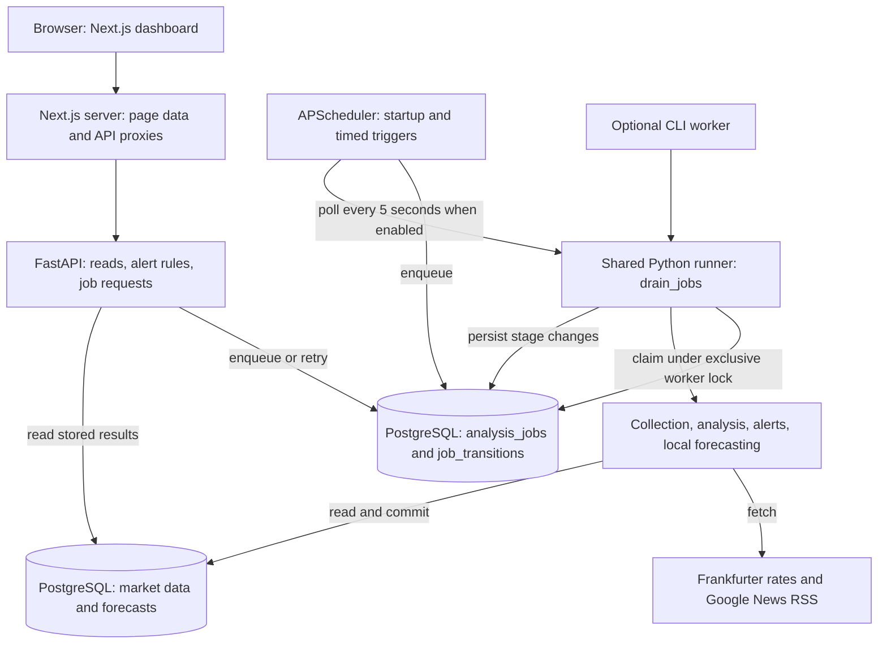
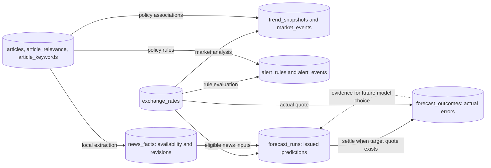

# Project map: workers, data, and state transitions

This guide describes the implementation in the repository, checked on October 21, 2026. It explains the running FastAPI/PostgreSQL/Next.js application first. The older Python/Node prototype is documented separately so its workers are not confused with the current backend.

## Reading order

| Guide | What it answers |
|---|---|
| **This page** | What runs, what communicates, and where the data lives |
| [Job states and recovery](job-states.md) | Every legal transition, retries, ownership, locks, and restart behavior |
| [Worker flows](worker-flows.md) | How rates, recent news, historical news, analysis, and forecast jobs execute |
| [Forecast lifecycle](forecast-lifecycle.md) | How models compete, predictions are saved, and actual outcomes influence later runs |
| [Legacy workers](legacy-workers.md) | How the earlier threaded Python/Node program differs |

Diagrams use Mermaid fenced blocks. Open these files in a Markdown viewer with Mermaid support, such as GitHub's rendered Markdown. Each diagram is followed by prose or a table so the guide is useful even in a plain text editor. Solid arrows describe calls, data movement, or state transitions as labeled; dotted arrows indicate a conditional follow-up.

## The running application

The queue is a PostgreSQL table, not Redis, Celery, or an in-memory message queue. The default worker runs in the API process through APScheduler. A separate Python worker can use the same queue. PostgreSQL permits only one participating runner to drain it at a time, so jobs execute serially even if several processes try to work.

**There are five job types, not five permanent worker processes.** The files under `app/workers/` are entry points into the same runner. Collectors, the analyzer, the alert evaluator, and the model trainer are functions called during a job. Only the durable job stages below are recorded as job states.

| Job type | Normal persisted path | Main output |
|---|---|---|
| `rates` | QUEUED → COLLECTING → ANALYZING → EVALUATING_ALERTS → COMPLETED | Rates, settled forecasts, trends, events, alerts |
| `news_recent` | QUEUED → COLLECTING → ANALYZING → EVALUATING_ALERTS → COMPLETED | Recent articles, extracted evidence, trends/events, alerts |
| `news_history` | QUEUED → COLLECTING → ANALYZING → EVALUATING_ALERTS → COMPLETED | Historical article batches, evidence, trends/events, alerts |
| `analysis` | QUEUED → ANALYZING → EVALUATING_ALERTS → COMPLETED | Recomputed results from existing inputs; no collection |
| `forecast` | QUEUED → EXTRACTING_HINTS → FORECASTING → COMPLETED | Saved candidate predictions for each currency and horizon |

Any running stage can fail. A failed job can be requeued; a completed job cannot transition back into execution. [The complete transition diagram](job-states.md#the-complete-job-state-machine) includes these paths.

## Triggers and timing

| Trigger | Behavior |
|---|---|
| API startup | Enqueues `rates`, `news_history`, and `news_recent`, in that order; drains if the embedded worker is enabled |
| Daily rate schedule | Enqueues `rates` at `DAILY_SYNC_HOUR:00` |
| Daily news schedule | Enqueues `news_recent` at `DAILY_SYNC_HOUR:20` |
| Worker interval | Attempts a drain every five seconds when `JOB_WORKER_ENABLED=true` |
| Dashboard action | POST creates or reuses a pending job; it does not run training inside that request |
| Successful rates/recent-news job | Enqueues `forecast` only if at least one forecast run already exists |
| CLI | Can enqueue a requested type and/or drain ready jobs |

Configuration defaults are **06:00 and 06:20, Asia/Seoul**. Rate lookback defaults to 365 calendar days and news-history lookback to 90; `.env` can override them. History collection runs at startup, not on a separate daily history cron. The default drain processes at most 20 jobs before returning. A long training job holds the worker slot until it finishes; the five-second interval does not interrupt it.

Sources: [scheduler](../../project/backend/app/services/pipeline/scheduler.py), [settings](../../project/backend/app/core/config.py), [API lifespan](../../project/backend/app/main.py).

## Where results live

Stored KRW-based rates are **foreign units per won**. The dashboard and forecasts use the reciprocal: **won per one foreign unit**. For example, a displayed USD cost of ₩1,400 means one dollar costs 1,400 won. Do not interpret a rise in the stored reciprocal rate as a rise in displayed won cost.

## Dashboard updates

The server-rendered dashboard reads stored rates, articles, trends, and events. Client panels poll through Next.js API proxies: background jobs every five seconds, forecasts every ten seconds, and alerts every thirty seconds. Job completion can call `router.refresh()` to update server-rendered market data. Polling a forecast only reads saved results; it does not train another model.

The job details endpoint returns ordered transition history. The leaderboard is also a read-only comparison; switching its ranking tab does not change a saved forecast. Alerts are stored in-app events, not email/SMS delivery.

Sources: [dashboard](../../project/frontend/app/dashboard/page.tsx), [jobs panel](../../project/frontend/components/jobs/job-panel.tsx), [forecast panel](../../project/frontend/components/forecasts/forecast-panel.tsx), [alerts panel](../../project/frontend/components/alerts/alert-panel.tsx).

## Source map

| Responsibility | Code |
|---|---|
| Legal states, enqueue, claim, retry, recovery | [state_machine.py](../../project/backend/app/services/pipeline/state_machine.py) |
| Worker exclusion and stage execution | [runner.py](../../project/backend/app/services/pipeline/runner.py) |
| Job/transition persistence | [models/jobs.py](../../project/backend/app/models/jobs.py) |
| Requests and history | [api/v1/jobs.py](../../project/backend/app/api/v1/jobs.py) |
| Local worker commands | [workers/run_jobs.py](../../project/backend/app/workers/run_jobs.py) |
| Rates and analysis | [services/rates](../../project/backend/app/services/rates) |
| Articles and evidence extraction | [services/news](../../project/backend/app/services/news) |
| Forecast models and scoring | [services/forecasting](../../project/backend/app/services/forecasting) |
| Alert rules | [services/alerts/engine.py](../../project/backend/app/services/alerts/engine.py) |

For setup, use the [backend README](../../project/backend/README.md) and [frontend README](../../project/frontend/README.md). For earlier implementation notes, see [job-state-machine.md](../job-state-machine.md), [news-forecasting.md](../news-forecasting.md), and [historical-data.md](../historical-data.md). Those documents include historical verification counts; this guide describes current control flow rather than a proposed design.
