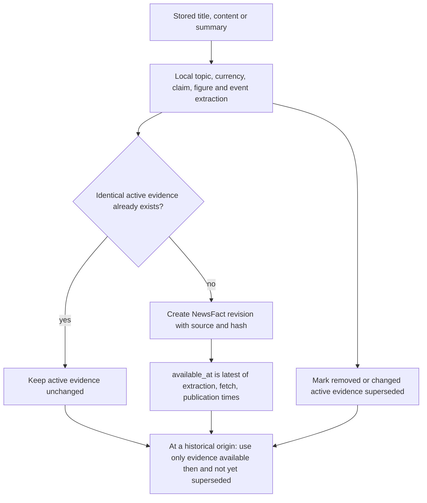
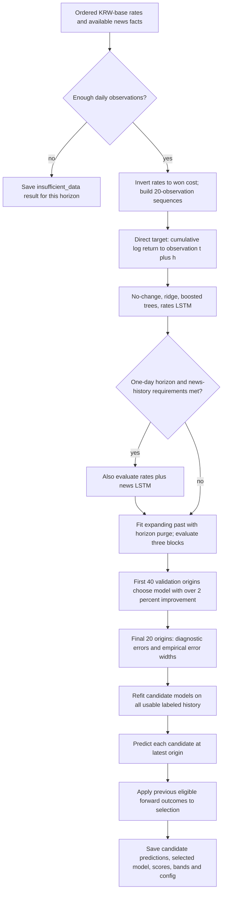
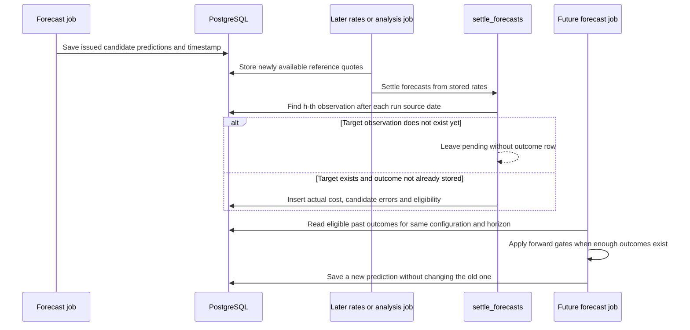
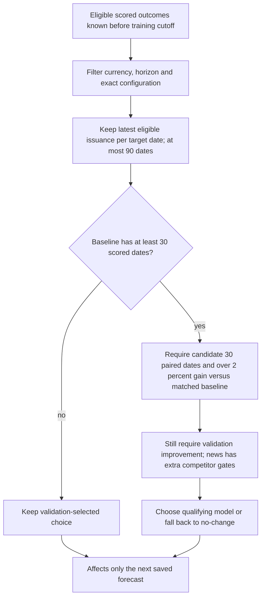

# Forecast training, model competition, and actual outcomes

[Project map](README.md) · [Worker flows](worker-flows.md) · [Job states](job-states.md)

The persisted job path is only `QUEUED → EXTRACTING_HINTS → FORECASTING → COMPLETED`. The diagrams below expand work inside those stages. Names such as “waiting for outcome” are conceptual lifecycle steps, not additional `AnalysisJob.state` values.

## News becomes time-aware evidence

This is a tested rules-based extractor, not a language model. It identifies source claims rather than independently verifying them. Reported actual/previous/expected values and surprises can be extracted when the wording supports them. Ambiguous attribution is excluded from numeric event inputs.

An article dated 2024 but first collected/extracted today cannot influence a 2024 simulated forecast. Collecting point-in-time history over successive days therefore matters. Revised evidence retains its availability interval rather than rewriting what earlier forecasts could have known.

Sources: [facts.py](../../project/backend/app/services/news/facts.py), [events.py](../../project/backend/app/services/news/events.py), [engine news_vector](../../project/backend/app/services/forecasting/engine.py).

## Training one currency at one horizon

Horizons are **1, 3, 5, and 10 future rate observations**, not calendar days. Each horizon trains its own direct model, rather than repeatedly applying a one-day prediction. Weekends and missing publication days delay the actual target observation. Currencies are USD, AUD, CAD, CHF, CNY, EUR, GBP, and JPY, each against KRW.

The rates LSTM uses a 20-observation sequence, 12 hidden units, 45 epochs by default, and a fixed seed. Ridge and boosted trees provide simpler competitors. The baseline predicts the latest cost unchanged. All candidates are retrained locally; model weights are not persisted as a serving artifact. Saved predictions and evaluation metadata are persisted.

The minimum history is `160 + 3 × (horizon − 1)` observations: 160, 166, 172, and 187 for horizons 1, 3, 5, and 10. Less history produces an `insufficient_data` payload, not a failed job.

The first two 20-origin evaluation blocks select a model. Horizon-sized training purges and gaps between evaluation blocks prevent labels from crossing into later evaluation origins. The final 20-origin block does not select the winner; its absolute errors set empirical 80th-percentile widths. These bands are not calibrated confidence intervals.

| News-model requirement | Minimum |
|---|---:|
| Horizon | 1 observation only |
| Training days with available news | 30 |
| Distinct first-seen dates before initial validation cutoff | 20 |
| Validation days with news | 15 |
| Final-test days with news | 8 |

The rates candidate must beat baseline validation MAE by **more than 2%**. A news candidate must beat both baseline and the best rates candidate by that margin. Without sufficient forward evidence, the validation-selected model remains the choice; the system does not wait 30 days before issuing its first non-baseline forecast. Once forward gating becomes active, the additional rules below apply.

One-day configuration remains `local-outlook-v5`; longer-horizon LSTM comparisons use `local-outlook-lstm-v6`. Full configuration equality, not just the version label, separates forward evidence. Old predictions remain stored.

Code: [engine.py](../../project/backend/app/services/forecasting/engine.py), [simple_models.py](../../project/backend/app/services/forecasting/simple_models.py).

## Save first, score later

Forecast jobs also call settlement at the start of training. Simply opening the forecast API does not settle outcomes or train models.

For each run and horizon, settlement uses the h-th stored quote after `as_of_date`. Error is `abs(predicted won cost − actual won cost)`. The outcome is written once per `(forecast_run_id, horizon)` and is not recalculated on later settlement runs. Repeated training today does not generate new independent outcome dates.

For forward-selection eligibility, the prediction must have been issued **before the first future quote's UTC day starts**, even for a 10-observation prediction. A prediction issued after part of its target path had already occurred is stored/scored as ineligible rather than admitted into selection evidence. This is deliberately conservative because exact historical quote publication times are not modeled.

## How forward results guide later choices

The established selection pipeline uses each candidate's matched-baseline sample. The leaderboard adds a stricter **common-date comparison across all candidates trained in the displayed run**, so its rows are ranked on identical dates. Its validation tab ranks historical errors; its live tab ranks genuine forward errors. It never ranks using the final held-out diagnostic block.

The live chart appears after two common scored dates and plots cumulative MAE within the displayed window. Before 30 dates, rankings are provisional. A leaderboard rank does not rewrite an issued prediction or directly trigger retraining. Overlapping multi-day target windows also mean different target dates are not necessarily independent errors.

Code: [scorecard.py](../../project/backend/app/services/forecasting/scorecard.py), [leaderboard.py](../../project/backend/app/services/forecasting/leaderboard.py), [forecast models](../../project/backend/app/models/forecasts.py).

## From prediction to a readable purchase comparison

The forecast API reads the latest saved currency run, selects a horizon, computes scorecard/leaderboard views, and checks freshness. A transparent timing heuristic shows “buy sooner” or “wait” only with active forward evidence, a non-baseline choice, fresh inputs, and an error band entirely above or below the current cost. Otherwise it shows no clear timing advantage or asks for refreshed inputs.

The amount calculator multiplies foreign units by won cost and the user-supplied markup. It is not a separate predictive model, and no transaction is executed. Reference quotes and empirical error bands cannot guarantee the actual bank offer.

Sources: [forecast API](../../project/backend/app/api/v1/forecasts.py), [outlook heuristic](../../project/backend/app/services/forecasting/outlook.py), [forecast UI](../../project/frontend/components/forecasts/forecast-outlook.tsx).
