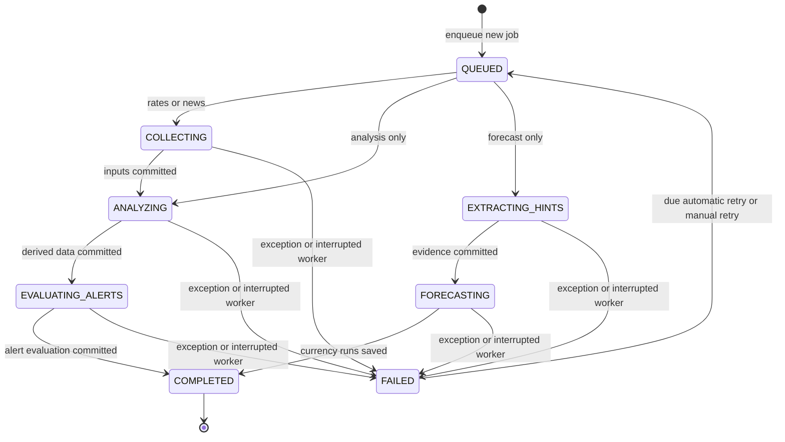
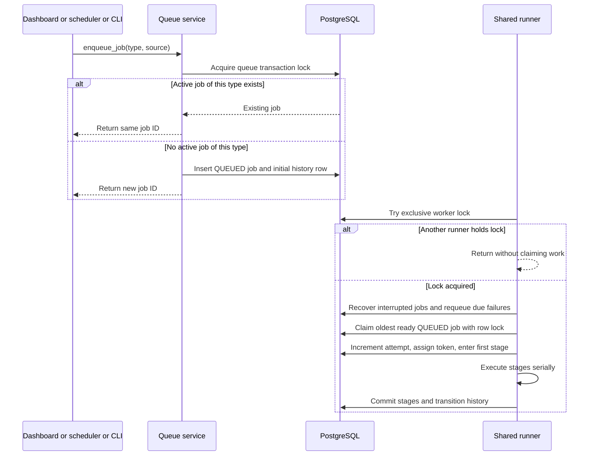
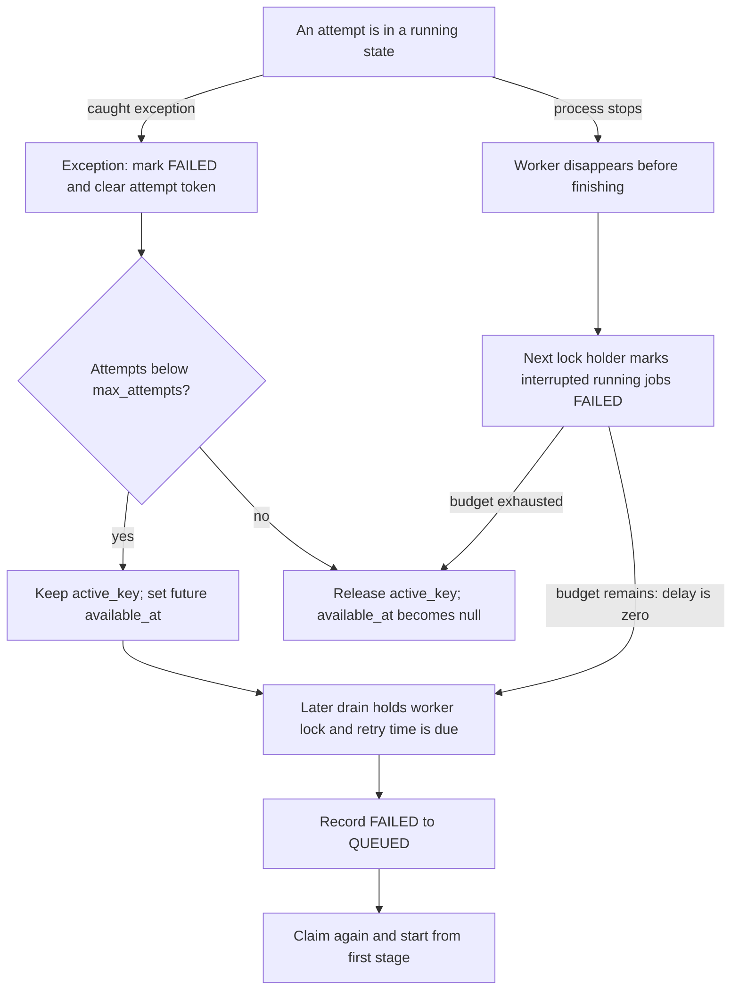

# Job states, ownership, and recovery

[Project map](README.md) · [Worker flows](worker-flows.md) · [Forecast lifecycle](forecast-lifecycle.md)

## The complete job state machine

These are the exact allowed edges in `TRANSITIONS`. Labels on edges out of `QUEUED` add the job-type restriction enforced by `transition()`.

`[*]` is diagram notation for creation/termination, not a database value. There is no persisted `IDLE`, `RETRYING`, `CANCELLED`, or per-model training state. A retry waiting for its deadline remains `FAILED` with a future `available_at`. A failed job with no scheduled retry stays `FAILED` until a manual retry is accepted.

| State | Meaning | Legal next states |
|---|---|---|
| `QUEUED` | Waiting for a runner and its availability time | `COLLECTING`, `ANALYZING`, or `EXTRACTING_HINTS`, according to job type |
| `COLLECTING` | Fetching and saving rate/news inputs | `ANALYZING`, `FAILED` |
| `ANALYZING` | Settling eligible outcomes where applicable; extracting news where applicable; rebuilding trends/events | `EVALUATING_ALERTS`, `FAILED` |
| `EVALUATING_ALERTS` | Checking enabled rules and storing nonduplicate events | `COMPLETED`, `FAILED` |
| `EXTRACTING_HINTS` | Forecast job extracts/revises local news evidence | `FORECASTING`, `FAILED` |
| `FORECASTING` | Settling old forecasts and training/saving new currency forecasts | `COMPLETED`, `FAILED` |
| `COMPLETED` | This job finished; its active slot is released | None |
| `FAILED` | Attempt failed; may be waiting for retry or have exhausted its budget | `QUEUED` |

The transition function validates the edge and records a `job_transitions` row. It also updates `state` and `updated_at`; its caller commits. Illegal edges raise `JobConflict`. The graph is enforced globally, with extra first-stage checks by job type; later edges are not a separate per-type graph.

## Submission and claim

`active_key` is unique and equals the job type while that type is pending, running, or waiting for an automatic retry. Duplicate submissions reuse that row. Different types can be queued simultaneously, but execution is serial. Claim order is `created_at`, then ID; retrying an old job does not create a new queue age.

Claiming increments `attempts`, creates a UUID `attempt_token`, sets `started_at`, clears prior error/result, and commits the first stage. The token is checked under a row lock before later stage transitions or failure recording, preventing an obsolete attempt from updating the job record.

## Failure, retries, and crash recovery

New jobs allow **three attempts total**. Ordinary failures schedule `30 × 2^(attempts − 1)` seconds of backoff: after attempt one, 30 seconds; after attempt two, 60 seconds; after attempt three, no automatic retry. A poll may pick up a retry later than its exact deadline.

Recovery happens only after obtaining the exclusive worker lock. This proves no other participating runner holds it; there is no heartbeat timeout that declares a slow LSTM job dead. Recovery records a failure for any persisted running stage. If budget remains, its retry is immediately due and is requeued in the same recovery pass.

Manual retry accepts only `FAILED` jobs with no other active job of the same type. It records `FAILED → QUEUED`, schedules it now, and extends `max_attempts` if necessary to allow at least one further claim. The next claim clears the old error. Completed jobs require a new submission rather than retry.

**Retries restart the whole job, not the failed stage.** Already committed rates, news batches, trends, or currency forecasts survive. A job is not one large transaction, and a failed job can therefore have useful partial output.

## Locks and transaction boundaries

| Mechanism | Scope | Purpose |
|---|---|---|
| Worker advisory lock `7314126503` | Dedicated PostgreSQL connection for the drain | Excludes other participating runners and archive importers |
| Queue advisory lock `7314126502` | Transaction | Serializes enqueue/retry/recovery queue changes |
| Market-write advisory lock `7314126501` | Transaction in services that request it | Serializes participating market read/modify/write operations |
| Row locks and attempt token | Job row/attempt | Protect claims and job-state ownership |
| Unique constraints | Database rows | Active type, rate/date identities, and outcome identities |

The worker lock covers service calls and network/model work for the drain; individual DB sessions are shorter lived. PostgreSQL releases its session lock when the owning connection disappears. Non-PostgreSQL test execution uses a process-local worker lock, which does not provide cross-process exclusion.

Attempt tokens fence job-state writes, not every business-data write inside each collector or trainer. The worker guard is the normal exclusion boundary for those operations. Some services also take the market-write lock; it should not be assumed that every write takes every lock.

## Reading the background log

| Field | Interpretation |
|---|---|
| `state` | Current stage, not percentage complete |
| `attempts / max_attempts` | Claims already made versus current budget |
| `available_at` | When the queue/retry can next become runnable; null after completion or exhausted failure |
| `result` | Counters saved at completed stage boundaries; not a live per-currency progress stream |
| `error` | Latest failure text, capped at 2,000 characters |
| `history` | Ordered transitions, attempts, messages, timestamps |

Example: `QUEUED → COLLECTING → FAILED → QUEUED → COLLECTING → ANALYZING → EVALUATING_ALERTS → COMPLETED` means collection failed once and succeeded after retry. A forecast can stay `FORECASTING` for minutes while saving currencies; there is no intermediate persisted `TRAINING_USD` state.

Sources: [state machine](../../project/backend/app/services/pipeline/state_machine.py), [runner](../../project/backend/app/services/pipeline/runner.py), [models](../../project/backend/app/models/jobs.py), [market lock](../../project/backend/app/db/locks.py), [state/worker tests](../../project/backend/tests/test_jobs.py).
