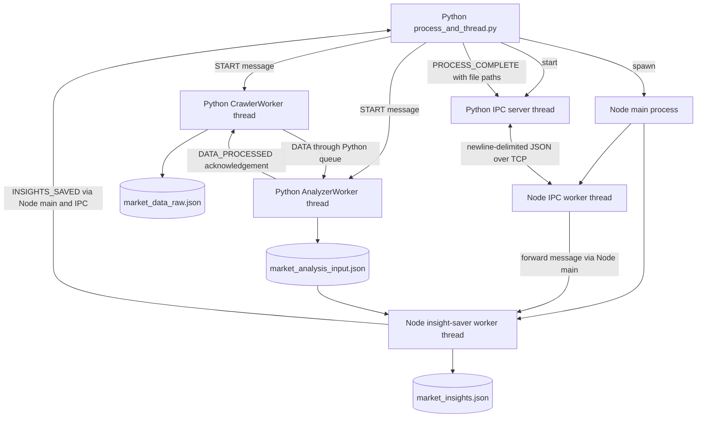
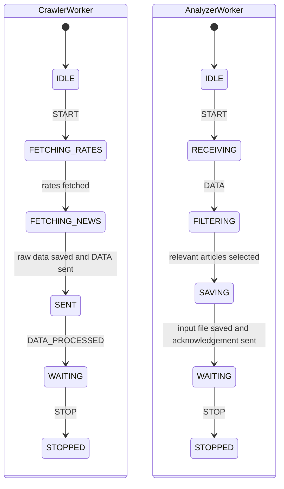
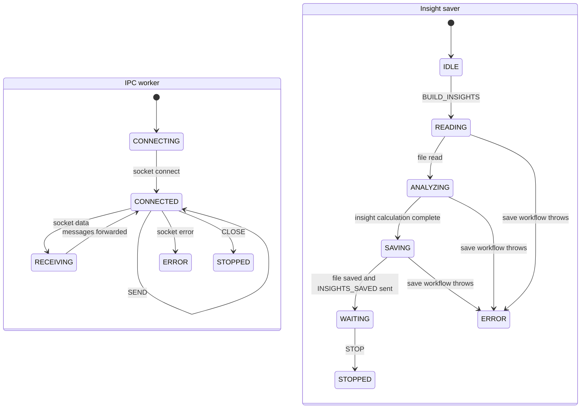

# Legacy Python and Node workers

[Current project map](README.md)

`project/legacy/` is a separate, earlier one-shot program. It does not power the Next.js dashboard, consume `analysis_jobs`, or share the current backend's durable state machine. Its state variables and transition logs describe progress in memory; the transition helpers do not enforce an allowed-edge registry like the current backend does.

## One-shot execution

The main Python script waits for queue work to finish, sends paths to Node, waits for `INSIGHTS_SAVED`, then explicitly stops Python workers and Node. Large payloads move through JSON files rather than being embedded in the TCP message. Queue `join()` waits for `task_done()` acknowledgements; it does not itself stop a worker thread.

## Python worker progress

These show the normal one-shot paths. Both workers also have `ERROR` states and handle `STOP` messages outside this happy path. The crawler fetches rates and news; the analyzer filters article relevance and writes Node's input. The base worker blocks on `Queue.get()`, handles the message, and acknowledges it in `finally`.

## Node worker progress

Node's main process routes IPC messages to the saver and routes save acknowledgements back to Python. The saver computes a five-day moving-average comparison and article-based summaries, writes the output, then waits. Its `STOP` handler can run whenever a stop message is received; it is not restricted to `WAITING`. IPC errors can likewise occur during socket use beyond the simplified connected-state edge shown here.

Unlike current PostgreSQL jobs, these progress states have no persisted attempts, automatic retry schedule, claim tokens, or crash recovery. Refer to [job-states.md](job-states.md) for those current guarantees.

Sources: [Python orchestration](../../project/legacy/process_and_thread.py), [Python worker states and handlers](../../project/legacy/thread_worker.py), [messages](../../project/legacy/thread_messages.py), [Python IPC](../../project/legacy/ipc_handler.py), [Node workers](../../project/legacy/node_process.js). Earlier detailed prototype documentation remains in [architecture.md](../architecture.md) and [data-flow.md](../data-flow.md).
