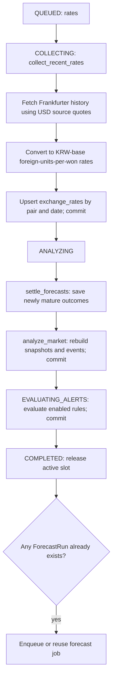
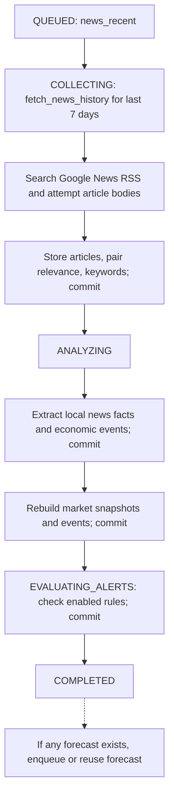
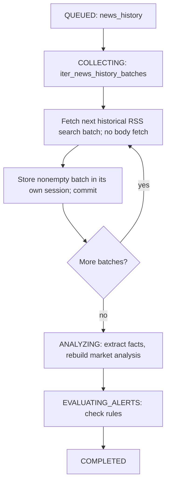
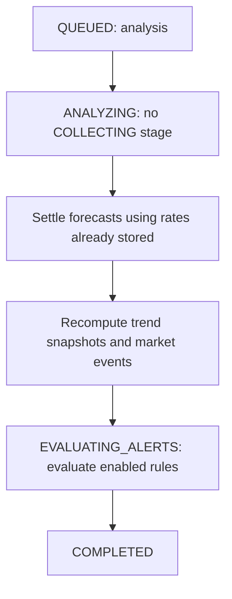
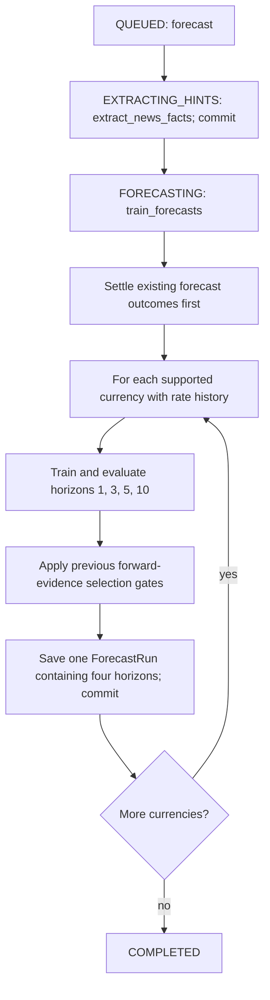
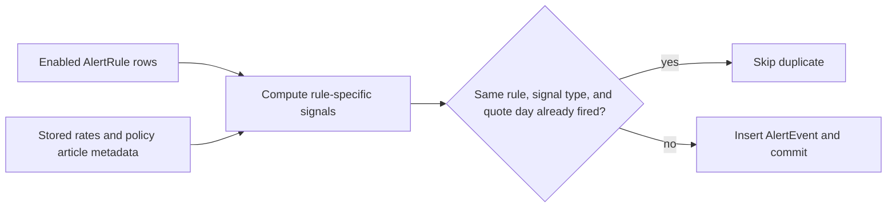

# How each worker job runs

[Project map](README.md) · [State machine and recovery](job-states.md) · [Forecast lifecycle](forecast-lifecycle.md)

All diagrams here describe the shared runner's normal execution. Uppercase labels are persisted job stages; other boxes are function-level work within a stage. Exceptions in any running stage take the job to `FAILED`, as shown in the [complete state machine](job-states.md#the-complete-job-state-machine).

## 1. Rates job

**Purpose:** collect a bounded daily history, score forecasts whose outcomes have arrived, rebuild market analysis, and evaluate alerts.

The collector fetches a calendar-day range determined by `RATE_HISTORY_DAYS`. It upserts existing dates instead of appending duplicates. For KRW base, it divides each currency's USD quote by the KRW-per-USD quote. Forecast scoring and the UI invert the stored rate into won cost.

`analyze_market(include_alerts=False)` calculates 5/20/60-observation averages, trend states, daily changes, price-change candidates, trend reversals, and policy/news associations. The runner then evaluates alerts in their own persisted stage. The follow-up forecast is conditional and is queued **after** the rates job has been marked complete.

Result counters include `rates`, `forecasts_scored`, `snapshots`, `events_created`, and `alerts_created`. Rate/snapshot counts describe rows processed, not necessarily newly inserted rows.

Code: [collector](../../project/backend/app/services/rates/collector.py), [analyzer](../../project/backend/app/services/rates/analyzer.py), [runner](../../project/backend/app/services/pipeline/runner.py).

## 2. Recent-news job

**Purpose:** collect recent news with attempted article-body extraction and turn it into local evidence and market context.

Article storage reuses URL identity, updates available text, computes relevance per currency pair, and inserts missing keywords. Body fetching is best effort; usable RSS text can remain when body extraction fails. A news job does not collect exchange rates, although analysis reads the rates already in the database.

Extraction is local and rule based: sentence/topic matching, currency mentions, claim type, reported direction, figures, and structured economic-event fields. It does not ask an LLM or assume that a reported increase means an exchange rate must rise. Evidence availability and revisions are recorded for later point-in-time evaluation.

Result counters include `articles`, `news_facts`, `snapshots`, `events_created`, and `alerts_created`. This path does not call forecast settlement directly; a subsequent forecast job settles old predictions at training start.

Code: [news collector](../../project/backend/app/services/news/collector.py), [facts extractor](../../project/backend/app/services/news/facts.py), [economic events](../../project/backend/app/services/news/events.py).

## 3. Historical-news job

**Purpose:** expand stored news within the configured rolling history window without fetching every article body.

The range is `NEWS_HISTORY_DAYS`; this is different from the fixed seven-day recent-news job. Empty batches skip storage. Earlier committed batches survive a later fetch failure; retries revisit the job from the beginning and reuse existing article identities.

History collection is a best-effort search archive, not a guarantee of every article ever published. An old publication date does not prove the downloaded text was available in that form at that time. New facts get present availability times and cannot be inserted into earlier news-model backtests. This job does **not** automatically enqueue forecast training on completion.

## 4. Analysis-only job

**Purpose:** refresh derived results after an import, rules change, or manual request without fetching external data.

Analysis-only does not extract news facts in this runner path and does not automatically enqueue forecast training. It reads stored article relevance/keywords for policy associations. The analyzer updates existing pair/date snapshots and event identities and removes obsolete generated market events. This makes reruns useful when source inputs change.

Code: [analyzer](../../project/backend/app/services/rates/analyzer.py), [signal rules](../../project/backend/app/services/rates/signals.py).

### Market trend labels are derived states

These describe the data, not worker execution. `classify_trend()` recalculates the label for each observation; there is no legal-transition registry between trend labels. A new observation or corrected input can change one label directly into any other.

| Condition | Trend label |
|---|---|
| Any of the 5/20/60 averages is unavailable | `insufficient_data` |
| MA5 > MA20 > MA60 | `uptrend` |
| MA5 < MA20 < MA60 | `downtrend` |
| Otherwise, including equal averages | `neutral` |

The displayed rate API recomputes moving averages in the requested quote direction. This matters because stored foreign-units-per-won trends and displayed won-cost trends use reciprocal rates. See [trends.py](../../project/backend/app/services/rates/trends.py).

## 5. Forecast job

**Purpose:** extract current evidence, evaluate competing local models, and save new predictions.

This path skips `COLLECTING`, `ANALYZING`, and `EVALUATING_ALERTS`. It trains from stored inputs and requires the local ML dependencies. The trainer saves each currency separately, so a failed later currency does not roll back earlier ones. Retries can create additional forecast runs; scoring limits repeated issues to one eligible issuance per target date in each scorecard cohort.

There are no permanent LSTM/ridge/boosted-tree worker processes. They are candidate fits inside `FORECASTING`, executed sequentially. The exact modeling and settlement steps are in [Forecast lifecycle](forecast-lifecycle.md).

## Alert evaluation shared by the non-forecast paths

Rules include won-cost thresholds, rate changes, reversals, change-point candidates, and policy/price associations. Alert creation is independent of the forecast leaderboard. A forecast does not automatically buy currency or send an external notification. Creating/updating/checking alert rules can also call the evaluator synchronously through the alerts API, outside the durable job state machine.

Code: [alert engine](../../project/backend/app/services/alerts/engine.py), [alerts API](../../project/backend/app/api/v1/alerts.py).

## Worker entry points and operations

Run commands from `project/backend` with the backend environment installed. On Windows, substitute `.\.venv\Scripts\python.exe` for `python` if the environment is not activated.

| Command | Behavior |
|---|---|
| `python -m app.workers.run_jobs` | Drain repeatedly, waiting five seconds between drains |
| `python -m app.workers.run_jobs --once` | Drain up to 20 ready jobs, then exit; does not wait for future retries |
| `python -m app.workers.run_jobs --job forecast --once` | Enqueue/reuse a forecast job, then drain the shared queue |
| `python -m app.workers.collect_rates` | Request rates, then drain |
| `python -m app.workers.collect_news` | Request/drain history, then request/drain recent news |
| `python -m app.workers.analyze_market` | Request analysis, then drain |

Requesting one type does not restrict the drain to that type. An older ready job may run first. If another process owns the worker lock, a drain returns immediately and the queued request remains for that worker or a later poll. To use a standalone worker, set `JOB_WORKER_ENABLED=false` for the API and keep the separate worker running. The API still schedules/enqueues collection jobs in that configuration.

### Archive importer: a separate operational path

`python -m app.cli.backfill_archive` imports explicit date ranges under the same worker guard. It is **not** a sixth durable job type: its fetch loop has no `AnalysisJob` stage history or automatic retry. It imports rates in up-to-365-day chunks, news in bounded windows, commits batches, extracts facts, and queues `analysis` and `forecast` afterward. It does not itself drain those follow-up jobs. A running embedded or standalone worker must process them.

See [historical import instructions](../historical-data.md) and [importer code](../../project/backend/app/cli/backfill_archive.py). Other maintenance CLIs can call services directly; do not interpret all command-line activity as a persisted pipeline job.
